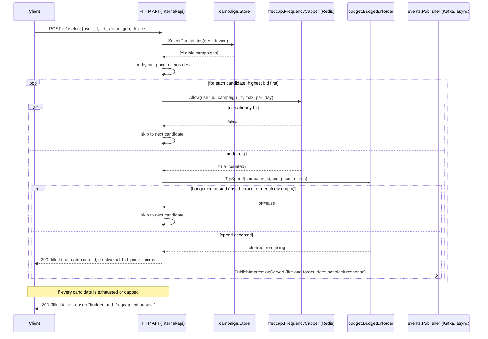

# Architecture

## Request flow



## ASCII version (same flow, for non-Mermaid viewers)

```
Client
  |
  |  POST /v1/select {user_id, ad_slot_id, geo, device}
  v
+----------------------------+
| internal/api.Handler       |
+----------------------------+
  |
  | SelectCandidates(geo, device)
  v
+----------------------------+
| campaign.Store             |  (in-memory v1; Postgres-backed impl
+----------------------------+   could slot in behind the same interface)
  |
  | candidates, sorted by bid desc
  v
for each candidate (highest bid first):
  +--------------------------------+     capped?     +------------------+
  | freqcap.FrequencyCapper.Allow  | --------------> | try next          |
  +--------------------------------+                 | candidate         |
  | under cap                                          +------------------+
  v
  +--------------------------------+   rejected?     +------------------+
  | budget.BudgetEnforcer.TrySpend | --------------> | try next          |
  +--------------------------------+                 | candidate         |
  | accepted                                           +------------------+
  v
  return Decision{filled:true, campaign_id, creative_id, bid_price_micros}
  |
  +--> (async, non-blocking) events.Publisher.PublishImpressionServed --> Kafka

if no candidate clears both checks:
  return Decision{filled:false, reason: "no_targeting_match" | "budget_and_freqcap_exhausted"}
```

## Component responsibilities

- **`internal/api`** -- HTTP transport only: parses/validates
  `SelectRequest`, calls `selector.Selector.Select`, serializes
  `SelectResponse`. No business logic lives here.
- **`internal/campaign`** -- campaign definitions (targeting rules, bid,
  daily budget cap) and the read-side `Store` interface. Does **not** own
  mutable "remaining budget" -- that's `internal/budget`'s job, kept
  deliberately separate so targeting and spend-accounting can be reasoned
  about, tested, and scaled independently.
- **`internal/budget`** -- the concurrency-correctness centerpiece. See the
  [ADR](adr/0001-naive-vs-atomic-budget-enforcement.md) for the full
  naive-vs-atomic story.
- **`internal/freqcap`** -- per-user-per-campaign-per-day impression caps
  via Redis `INCR`+`EXPIRE`, wrapped in a Lua script so the
  increment-check-rollback sequence is atomic.
- **`internal/events`** -- a deliberately thin fire-and-forget Kafka
  publisher. Not a processing pipeline; downstream aggregation/analytics is
  explicitly out of scope for this project.
- **`internal/metrics`** -- Prometheus collectors: request latency
  histogram (labeled by outcome), budget-rejected counter, no-fill counter.
- **`internal/selector`** -- orchestrates the above into one
  `Select(ctx, Request) (Decision, error)` call. This is the only package
  that depends on all the others; everything else only depends on
  interfaces.
- **`pkg/client`** -- a small, dependency-free Go SDK for `POST
  /v1/select`, used by `cmd/loadtest` and available for other services to
  import.

## A known, intentional simplification

`internal/selector.Selector.selectOnce` calls `FreqCap.Allow` (which
increments the frequency counter) *before* `Budget.TrySpend`. If the budget
spend is then rejected, the user has already "used up" one frequency-cap
slot for a campaign they were never actually shown. A stricter design would
reserve-then-commit across both Redis keys atomically (e.g. a single Lua
script touching both the freqcap and budget keys, or a two-phase
commit/rollback). This is called out explicitly, rather than hidden, as a
reasonable v1 trade-off: it only very slightly under-serves a user's
frequency cap in the rare case a campaign runs out of budget mid-request,
which is a much smaller correctness problem than the budget double-spend
this project is built to solve.

## Why Redis Lua scripts (and not, say, distributed locks)?

A distributed lock (e.g. Redlock) around "read balance, check, write
balance" would also fix the race, but it adds round trips, lock-timeout
tuning, and a whole extra failure mode (lock expiring mid-critical-section
under GC pause / network blip). A single Lua script achieves the same
"read+check+write is atomic" property using a guarantee Redis already
provides for free -- it executes one script to completion, without
interleaving any other client's command, before touching the next one. No
lock to acquire, hold, expire, or fail to release.
