# AdSelector: Real-World Walkthrough

> **Audience:** Backend engineers reading the repo + Product managers who need plain English.
>
> Every section includes: (1) plain-English story, (2) Mermaid diagrams, (3) exact file references, (4) engineering pattern.

---

## Table of Contents

1. [The Problem — Why This System Exists](#1-the-problem--why-this-system-exists)
2. [High-Level Architecture](#2-high-level-architecture)
3. [Step 1 — The Ad Request Arrives](#3-step-1--the-ad-request-arrives)
4. [Step 2 — Targeting: Who Sees What](#4-step-2--targeting-who-sees-what)
5. [Step 3 — Ranking: Highest Bidder Wins](#5-step-3--ranking-highest-bidder-wins)
6. [Step 4 — Frequency Capping: Don't Annoy Users](#6-step-4--frequency-capping-dont-annoy-users)
7. [Step 5 — Budget Enforcement: Don't Overspend](#7-step-5--budget-enforcement-dont-overspend)
8. [Step 6 — Event Publishing: Tell the Data Team](#8-step-6--event-publishing-tell-the-data-team)
9. [Step 7 — Observability: Know When Things Break](#9-step-7--observability-know-when-things-break)
10. [The Full Pipeline: End-to-End Flow](#10-the-full-pipeline-end-to-end-flow)
11. [Infrastructure: How It Runs](#11-infrastructure-how-it-runs)
12. [Dependency Injection: Wiring It All Together](#12-dependency-injection-wiring-it-all-together)
13. [The Concurrency Bug: A Cautionary Tale](#13-the-concurrency-bug-a-cautionary-tale)
14. [Load Testing: Proving It Works Under Pressure](#14-load-testing-proving-it-works-under-pressure)

---

## 1. The Problem — Why This System Exists

### Plain English

Imagine you're **Spotify**. Every time a free-tier user opens the app, you need to show them an ad. But it's not random — you have hundreds of advertisers (Nike, McDonald's, Samsung) each paying different amounts, targeting different audiences, with daily budgets they don't want exceeded. You need to pick the *best* ad in **under 50 milliseconds** — before the user's page finishes loading.

The same problem exists at **YouTube** (pre-roll video ads), **The New York Times** (banner ads between articles), **Reddit** (promoted posts), and any platform that monetizes attention through advertising.

**AdSelector** is the microservice that answers one question: *"Given this user, on this device, in this country, which ad should I show them right now?"*

### The Real Companies With This Problem

| Company | Ad Format | Scale | Why It's Hard |
|---------|-----------|-------|---------------|
| **Spotify** | Audio ads between songs | 600M+ users, multiple ads per session | Must pick in <50ms or the silence gap is noticeable |
| **The New York Times** | Display banners, native ads | Millions of page views/day | Premium advertisers have strict frequency caps — readers must not feel bombarded |
| **Reddit** | Promoted posts in feed | Billions of feed impressions/month | Budget enforcement matters — a small advertiser with $500/day can't accidentally spend $5,000 |
| **Twitch** | Pre-roll and mid-roll video | Concurrent viewership spikes during events | Must handle 10x traffic spikes without overspending budgets |

### Engineering Pattern: **Domain-Driven Design (DDD)**

The entire codebase is organized around the *ad selection domain*: campaigns, budgets, frequency caps, and impression events. Each of these is a separate bounded context with its own interface, types, and rules. The code doesn't know about "users" in a general sense — it only knows about "impression requests."

---

## 2. High-Level Architecture

### Plain English

AdSelector is a single Go microservice that sits between two worlds:

- **Upstream:** The frontend (website/app/player) that needs an ad to show.
- **Downstream:** Redis (for real-time state like budgets and frequency caps), Kafka (for publishing impression events to data pipelines), and Prometheus (for monitoring).

When a request comes in, the service runs a pipeline: filter campaigns by targeting → rank by bid price → check frequency caps → check budget → publish event → respond.

### High-Level System Diagram

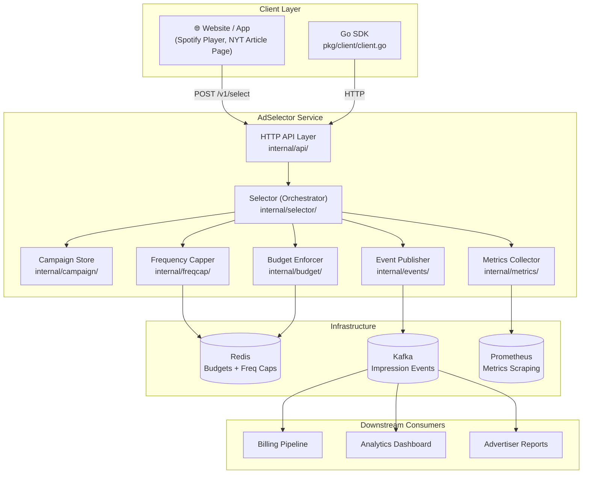

### Repo Files

| Component | File(s) |
|-----------|---------|
| Entire service entrypoint | [`cmd/server/main.go`](../cmd/server/main.go) |
| HTTP layer | [`internal/api/handler.go`](../internal/api/handler.go), [`internal/api/router.go`](../internal/api/router.go) |
| Orchestrator | [`internal/selector/selector.go`](../internal/selector/selector.go) |
| Infrastructure config | [`docker-compose.yml`](../docker-compose.yml) |

### Engineering Pattern: **Ports and Adapters (Hexagonal Architecture)**

The `selector` package is the core "hexagon." It depends only on *interfaces* (`campaign.Store`, `budget.BudgetEnforcer`, `freqcap.FrequencyCapper`, `events.Publisher`). The actual Redis/Kafka/in-memory implementations are "adapters" plugged in from outside. You could swap Redis for DynamoDB without touching the orchestrator.

---

## 3. Step 1 — The Ad Request Arrives

### Plain English — Spotify Scenario

A user in Canada opens Spotify's free tier. Between songs, Spotify's player needs to show an audio ad. The player makes an HTTP call to AdSelector:

```json
{
  "user_id": "usr_a1b2c3",
  "ad_slot_id": "audio_between_songs",
  "geo": "CA",
  "device": "mobile"
}
```

This says: "I have a mobile user in Canada, and I need an ad for the between-songs audio slot."

The API handler receives this, validates it (user_id and ad_slot_id are required), and passes it to the selector.

### Low-Level Diagram: Request Handling

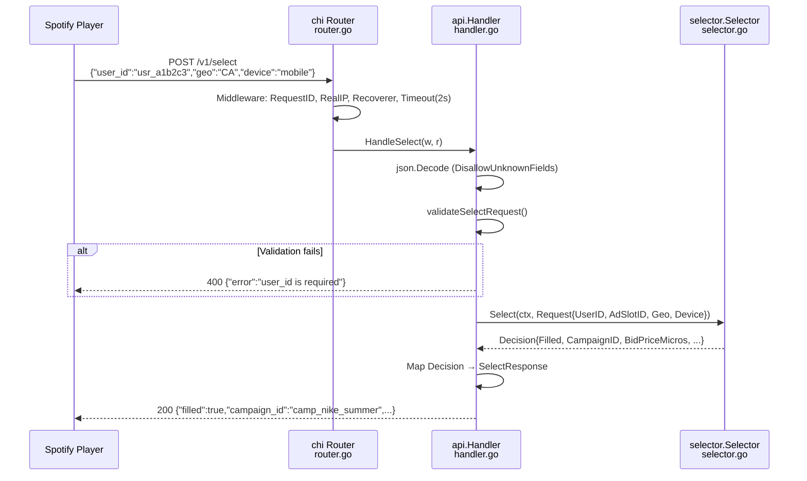

### Repo Files

| What | File | Key Lines |
|------|------|-----------|
| Request/Response types | [`internal/api/types.go`](../internal/api/types.go) | `SelectRequest`, `SelectResponse` structs |
| Request validation | [`internal/api/handler.go`](../internal/api/handler.go) | `validateSelectRequest()` function |
| Route registration | [`internal/api/router.go`](../internal/api/router.go) | `r.Post("/v1/select", h.HandleSelect)` |
| Health check | [`internal/api/handler.go`](../internal/api/handler.go) | `HandleHealthz()` |

### Engineering Pattern: **Anti-Corruption Layer**

The API types (`SelectRequest`, `SelectResponse`) are separate from the domain types (`selector.Request`, `selector.Decision`). This means the HTTP contract (JSON field names, status codes) can evolve independently of the business logic. If you add a GraphQL endpoint tomorrow, the selector doesn't change — you just write a new handler that maps GraphQL inputs to `selector.Request`.

---

## 4. Step 2 — Targeting: Who Sees What

### Plain English — New York Times Scenario

The New York Times has four active campaigns:

| Campaign | Advertiser | Targeting | Bid |
|----------|-----------|-----------|-----|
| "Acme Shoes" | Acme Corp | US & CA, mobile only | $2.50 |
| "Globex Travel" | Globex Inc | Desktop only | $1.80 |
| "Initech Insurance" | Initech GmbH | DE, FR, NL only | $3.20 |
| "Umbrella Corp" | Umbrella Corp | Everyone, everywhere | $0.10 |

A reader in **Germany on desktop** opens an article. Which campaigns *could* be shown?

- ❌ Acme Shoes — targets US/CA only (reader is in DE)
- ✅ Globex Travel — targets desktop (matches)
- ✅ Initech Insurance — targets DE (matches)
- ✅ Umbrella Corp — no targeting restrictions (matches everything)

The campaign store filters and returns: Globex Travel, Initech Insurance, Umbrella Corp.

### Low-Level Diagram: Targeting Filter

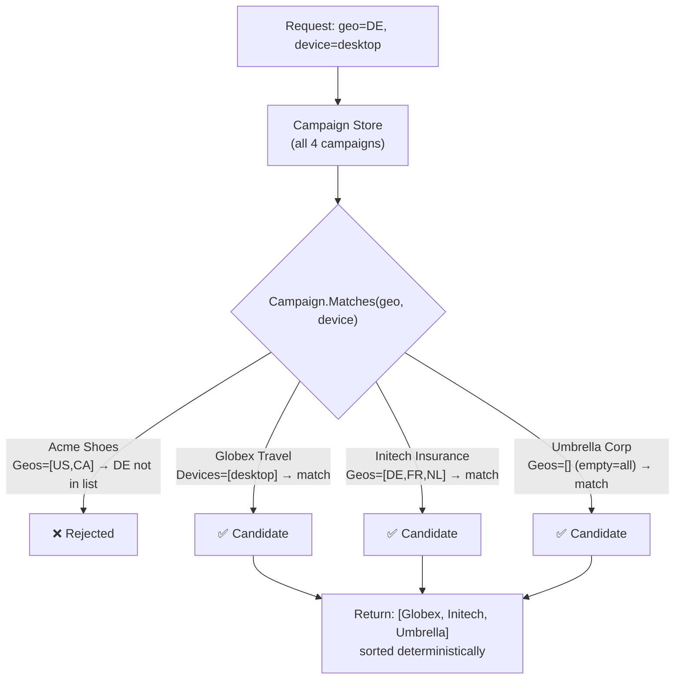

### Repo Files

| What | File | Key Lines |
|------|------|-----------|
| Campaign model & `Matches()` | [`internal/campaign/types.go`](../internal/campaign/types.go) | `func (c Campaign) Matches(geo, device string) bool` |
| Targeting rules | [`internal/campaign/types.go`](../internal/campaign/types.go) | `matchesDimension()` — empty list means "match all" |
| Store interface | [`internal/campaign/store.go`](../internal/campaign/store.go) | `Store` interface: `SelectCandidates(ctx, geo, device)` |
| In-memory implementation | [`internal/campaign/store.go`](../internal/campaign/store.go) | `InMemoryStore` with `sync.RWMutex` |
| Sample campaign data | [`cmd/server/main.go`](../cmd/server/main.go) | `seedCampaigns()` function |

### Engineering Pattern: **Repository Pattern + Strategy Pattern**

The `campaign.Store` interface is a Repository — it abstracts data access behind a clean interface. The targeting logic (`Matches()`) is a Strategy embedded in the domain model. The store calls `Matches()` on each campaign, but the matching *rules* live on the `Campaign` struct itself, not in the store. This means you can change how targeting works (add "language" or "time of day") without touching the data access layer.

---

## 5. Step 3 — Ranking: Highest Bidder Wins

### Plain English — Reddit Scenario

Reddit's promoted posts work like an auction. When three advertisers all target the same user in the same feed position, Reddit picks the one willing to pay the most per impression.

Continuing the NYT example — three campaigns passed targeting:

1. **Initech Insurance** — bids $3.20 per impression
2. **Globex Travel** — bids $1.80 per impression
3. **Umbrella Corp** — bids $0.10 per impression

AdSelector sorts them highest-bid-first: Initech → Globex → Umbrella. It then tries Initech first (the most money). If Initech fails a downstream check (budget or frequency cap), it falls through to Globex, then Umbrella.

### Low-Level Diagram: Ranking

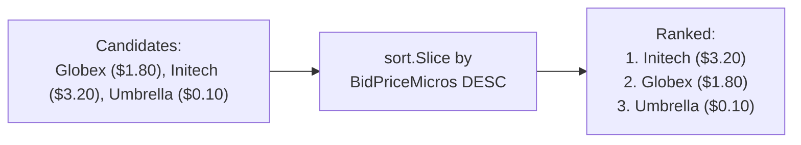

### Repo Files

| What | File | Key Lines |
|------|------|-----------|
| Sort by bid price | [`internal/selector/selector.go`](../internal/selector/selector.go) | `sort.Slice(candidates, ...)` with `BidPriceMicros` comparison |
| Bid price storage | [`internal/campaign/types.go`](../internal/campaign/types.go) | `BidPriceMicros int64` (micros = millionths of a dollar) |

### Engineering Pattern: **First-Price Auction (Simplified)**

This is a first-price auction: the highest bidder wins and pays their full bid. Real ad exchanges (Google Ad Exchange, The Trade Desk) often use second-price or modified auctions. The pattern here is intentionally simple — the ranking logic is a single `sort.Slice`, making it trivial to swap in a more sophisticated auction mechanism (e.g., one that factors in predicted click-through rate or advertiser quality score).

**Why micros?** Money is stored as `int64` in millionths of a dollar (1,000,000 micros = $1.00). This avoids floating-point rounding errors. A bid of $2.50 is stored as `2_500_000`. This is industry-standard — Google Ads, Meta, and Amazon DSP all use micros internally.

---

## 6. Step 4 — Frequency Capping: Don't Annoy Users

### Plain English — Twitch Scenario

A Twitch viewer watches 8 hours of streams. The same Samsung Galaxy ad plays before *every single stream*. The viewer is now annoyed and associates Samsung with annoyance.

Frequency capping prevents this. Each campaign sets a limit: "Show this ad to any individual user at most N times per day." Samsung might set `FrequencyCapPerDay: 3`. On the 4th impression request for the same user, the system says "no" and falls through to the next candidate.

### How It Works

For each candidate (in bid-price order), AdSelector asks Redis: "Has user `usr_a1b2c3` already seen campaign `camp_samsung` 3 times today?"

Redis stores a counter key like `freqcap:camp_samsung:usr_a1b2c3:20260929` and uses a Lua script to atomically:

1. Increment the counter
2. Set a 25-hour expiry on first increment (so it auto-cleans)
3. Check if the new count exceeds the cap
4. If over cap, decrement (roll back) and return "denied"

### Low-Level Diagram: Frequency Cap Check

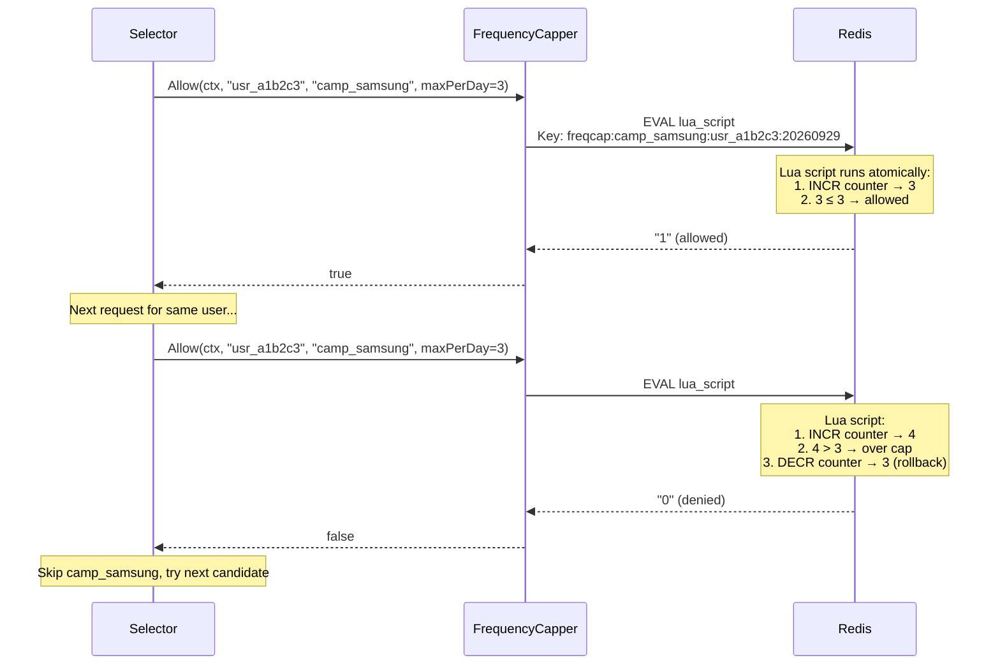

### Repo Files

| What | File | Key Lines |
|------|------|-----------|
| FrequencyCapper interface | [`internal/freqcap/interface.go`](../internal/freqcap/interface.go) | `Allow(ctx, userID, campaignID, maxPerDay) (bool, error)` |
| Redis Lua implementation | [`internal/freqcap/redis.go`](../internal/freqcap/redis.go) | `incrAndCapScript` — the atomic Lua script |
| Noop (dev mode) | [`internal/freqcap/noop.go`](../internal/freqcap/noop.go) | Always returns `true` — for local dev without Redis |
| Cap value on campaign | [`internal/campaign/types.go`](../internal/campaign/types.go) | `FrequencyCapPerDay int` field |
| Where it's called | [`internal/selector/selector.go`](../internal/selector/selector.go) | `s.FreqCap.Allow(...)` in the candidate loop |

### Engineering Pattern: **Atomic Check-and-Mutate via Lua Scripts**

Redis Lua scripts run atomically — no other command can interleave between the INCR and the cap check. This eliminates the race condition where two concurrent requests both read "count=2" (under cap of 3), both increment, and the user ends up seeing 4 impressions. The Lua script is a single `EVAL` call: the entire check-increment-rollback logic executes on the Redis server in one uninterruptible step.

**Noop pattern:** The `NoopCapper` is a Null Object — it satisfies the interface but does nothing. This lets you run the service locally without Redis. The selector doesn't know or care which implementation it's talking to.

---

## 7. Step 5 — Budget Enforcement: Don't Overspend

### Plain English — Reddit Small Advertiser Scenario

A local pizza shop runs a Reddit ad with a $50/day budget at $0.50 per impression. That's 100 impressions per day. The problem: at midnight, Reddit gets a surge of traffic. If 200 requests arrive simultaneously, a naive system might serve 200 impressions before realizing the budget is gone — the pizza shop gets billed $100 instead of $50.

This is the **double-spend problem**, and it's the core concurrency challenge this codebase was built to demonstrate.

### The Three Implementations

AdSelector ships three budget enforcement strategies to illustrate the evolution from broken to correct:

```mermaid
flowchart TB
    subgraph "❌ NaiveTracker (BROKEN)"
        N1["Thread A: Read balance = $50"]
        N2["Thread B: Read balance = $50"]
        N3["Thread A: $50 ≥ $0.50? Yes → Spend"]
        N4["Thread B: $50 ≥ $0.50? Yes → Spend"]
        N5["Both succeed!<br/>Budget should be $49, but both<br/>wrote $49.50 independently"]
        N1 --> N3
        N2 --> N4
        N3 --> N5
        N4 --> N5
    end

    subgraph "✅ InMemoryAtomicTracker (CORRECT — single node)"
        A1["Thread A: Load balance = $50"]
        A2["Thread A: CompareAndSwap($50 → $49.50)"]
        A3["Thread B: Load balance = $50"]
        A4["Thread B: CompareAndSwap($50 → $49.50) — FAILS<br/>(balance is now $49.50, not $50)"]
        A5["Thread B: Retry → Load $49.50 → CAS($49.50 → $49.00) — SUCCESS"]
        A1 --> A2
        A3 --> A4
        A4 --> A5
    end

    subgraph "✅ RedisAtomicTracker (CORRECT — distributed)"
        R1["Any server: EVAL Lua script"]
        R2["Lua: GET balance → $50"]
        R3["Lua: $50 ≥ $0.50? Yes"]
        R4["Lua: SET balance = $49.50"]
        R5["All steps atomic — no interleaving possible"]
        R1 --> R2 --> R3 --> R4 --> R5
    end
```

### Low-Level Diagram: CAS Loop (In-Memory)

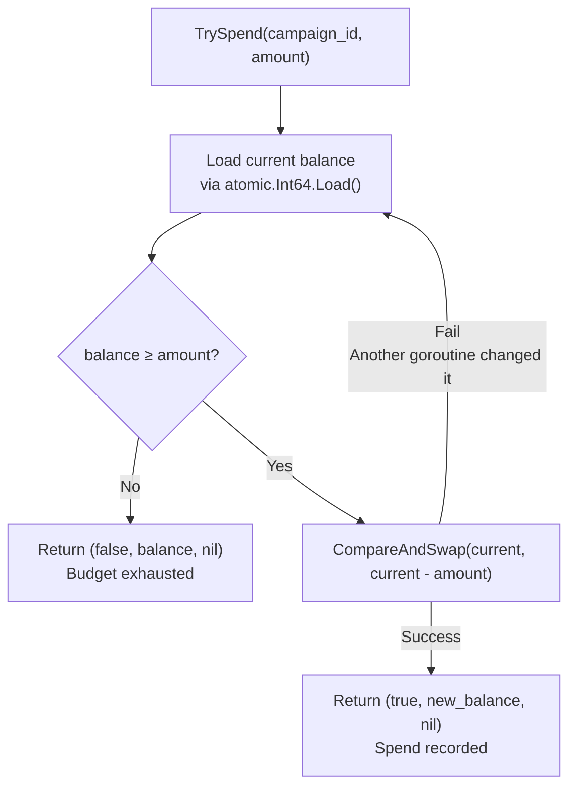

### Repo Files

| What | File | Key Lines |
|------|------|-----------|
| BudgetEnforcer interface | [`internal/budget/interface.go`](../internal/budget/interface.go) | `TrySpend`, `SetBudget`, `Remaining` |
| Naive (broken) impl | [`internal/budget/naive.go`](../internal/budget/naive.go) | TOCTOU race between read and write |
| Atomic CAS impl | [`internal/budget/atomic.go`](../internal/budget/atomic.go) | `atomic.Int64` + CAS loop |
| Redis Lua impl | [`internal/budget/redis.go`](../internal/budget/redis.go) | `spendScript` — single EVAL |
| Tests proving the race | [`internal/budget/naive_test.go`](../internal/budget/naive_test.go) | 20 goroutines, $10 budget, $1 spends |
| ADR documenting the decision | [`docs/adr/0001-naive-vs-atomic-budget-enforcement.md`](../docs/adr/0001-naive-vs-atomic-budget-enforcement.md) | Full reasoning |

### Engineering Pattern: **Compare-And-Swap (CAS) / Optimistic Concurrency Control**

Instead of locking (which blocks all other threads), the CAS pattern is *optimistic*: it assumes no contention, loads the current value, computes the new value, and tries to swap. If another thread changed the value in the meantime, the swap fails and we retry. This gives us lock-free, wait-free budget enforcement that scales linearly with CPU cores.

The Redis variant uses a **Lua script** instead of CAS because Redis is single-threaded — the Lua script is inherently atomic. No locks needed, no retries needed. One round-trip, one atomic operation.

**Architecture Decision Record (ADR):** The repo includes a formal ADR at [`docs/adr/0001-naive-vs-atomic-budget-enforcement.md`](../docs/adr/0001-naive-vs-atomic-budget-enforcement.md) documenting *why* the naive approach was rejected. This is a best practice for recording non-obvious technical decisions.

---

## 8. Step 6 — Event Publishing: Tell the Data Team

### Plain English — Spotify Billing Scenario

Every time Spotify shows a Nike ad, it needs a paper trail:

- **Billing:** Nike gets charged $2.50 for this impression.
- **Analytics:** The data team tracks which campaigns are performing well.
- **Reporting:** Nike's marketing team sees a dashboard: "Your ad was shown 50,000 times today."

AdSelector fires an `ImpressionServed` event into Kafka after every successful ad selection. Downstream consumers (billing service, analytics pipeline, reporting dashboard) read from Kafka independently.

### Low-Level Diagram: Event Publishing

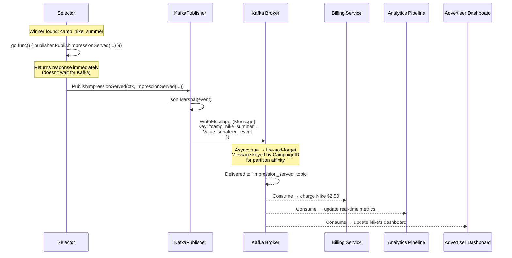

### The Event Payload

```json
{
  "event_id": "evt_unique_uuid",
  "served_at": "2026-09-29T14:30:00Z",
  "user_id": "usr_a1b2c3",
  "ad_slot_id": "audio_between_songs",
  "campaign_id": "camp_nike_summer",
  "creative_id": "cr_nike_air_max_audio_30s",
  "bid_price_micros": 2500000,
  "geo": "CA",
  "device": "mobile"
}
```

### Repo Files

| What | File | Key Lines |
|------|------|-----------|
| Event struct | [`internal/events/types.go`](../internal/events/types.go) | `ImpressionServed` — all fields for billing/analytics |
| Publisher interface | [`internal/events/publisher.go`](../internal/events/publisher.go) | `PublishImpressionServed`, `Close` |
| Kafka implementation | [`internal/events/kafka.go`](../internal/events/kafka.go) | `Async: true`, keyed by CampaignID |
| Fire-and-forget call | [`internal/selector/selector.go`](../internal/selector/selector.go) | `go func() { s.Events.PublishImpressionServed(...) }()` |

### Engineering Pattern: **Event-Driven Architecture + Fire-and-Forget**

The ad selection response is on the critical path (must be fast). Event publishing is on a *non-critical path* (can be slightly delayed). By firing the Kafka publish in a background goroutine with `Async: true`, the selector never blocks on Kafka's network round-trip. If Kafka is temporarily slow or down, the ad response still goes back to the user in <50ms.

**Partition keying:** Messages are keyed by `CampaignID`. Kafka guarantees ordering within a partition, so all events for the same campaign land in the same partition in order. This makes per-campaign billing aggregation straightforward for downstream consumers.

**Trade-off:** Fire-and-forget means events *can* be lost if the process crashes before Kafka acknowledges. In production, you'd add a dead-letter queue or write-ahead log. The codebase documents this simplification.

---

## 9. Step 7 — Observability: Know When Things Break

### Plain English — Any Company at Scale

At 3 AM, the on-call engineer gets paged: "Ad fill rate dropped from 92% to 15%." They need to know *why* — immediately. Is it a budget issue? A Redis outage? A targeting misconfiguration?

AdSelector exports three Prometheus metrics that answer these questions:

| Metric | What It Tells You |
|--------|-------------------|
| `adselector_http_select_request_duration_seconds` | How fast are ad decisions? Broken down by outcome (filled/no_fill/error). |
| `adselector_budget_rejected_total` | How many impressions were lost because campaigns ran out of budget? |
| `adselector_select_no_fill_total` | How many requests returned no ad at all? |

### Low-Level Diagram: Metrics Flow

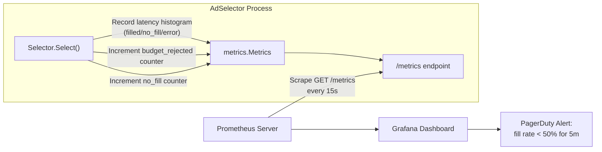

### Repo Files

| What | File | Key Lines |
|------|------|-----------|
| Metric definitions | [`internal/metrics/metrics.go`](../internal/metrics/metrics.go) | `HistogramVec`, `Counter` definitions |
| Recording in selector | [`internal/selector/selector.go`](../internal/selector/selector.go) | `s.Metrics.SelectDuration.WithLabelValues(outcome).Observe(elapsed)` |
| Prometheus endpoint | [`internal/api/router.go`](../internal/api/router.go) | `r.Get("/metrics", m.Handler().ServeHTTP)` |

### Engineering Pattern: **RED Metrics (Rate, Errors, Duration)**

The three metrics follow the RED method, an industry standard for microservice observability:

- **Rate:** Derived from the histogram's `_count` — how many requests per second?
- **Errors:** The `no_fill` and `budget_rejected` counters — what's failing?
- **Duration:** The histogram buckets — how fast are decisions?

This is the same approach used by Google SRE, Netflix, and Uber for monitoring their ad-serving infrastructure.

---

## 10. The Full Pipeline: End-to-End Flow

### Plain English

Here's the complete story for a single ad request, from the moment a NYT reader loads an article to the moment Nike's dashboard updates:

1. Reader's browser requests an ad for a banner slot.
2. AdSelector receives the request, validates it.
3. Filters 4 campaigns down to 3 (targeting match).
4. Sorts by bid: Initech ($3.20) → Globex ($1.80) → Umbrella ($0.10).
5. Checks Initech: frequency cap OK (user hasn't seen it today), budget OK ($3.20 deducted).
6. Initech wins. Fires an impression event to Kafka.
7. Returns response in 12ms: "Show Initech Insurance creative XYZ, charge $3.20."
8. Billing service reads the Kafka event, charges Initech's account.
9. Analytics pipeline updates real-time fill-rate dashboards.

### End-to-End Sequence Diagram

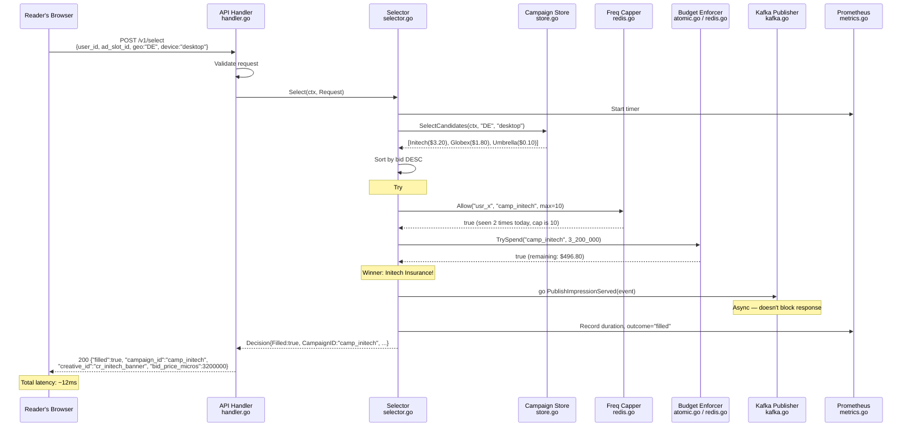

### The Waterfall: What If the Top Bidder Fails?

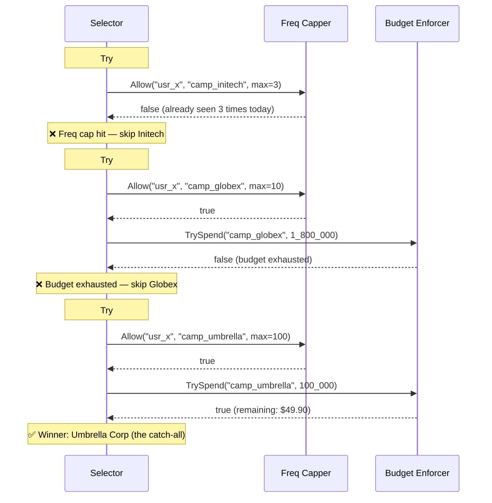

### Repo Files

The entire flow is orchestrated in **one function**:

| What | File |
|------|------|
| The `selectOnce()` method — the entire pipeline | [`internal/selector/selector.go`](../internal/selector/selector.go) |

### Engineering Pattern: **Pipeline / Chain of Responsibility**

The selector implements a decision pipeline: each candidate runs through a sequence of checks (frequency cap → budget). The first candidate to pass all checks wins. Failed candidates are skipped silently, and the next one is tried. This is the Chain of Responsibility pattern — each check acts as a gate, and the chain terminates at the first full success or exhaustion.

---

## 11. Infrastructure: How It Runs

### Plain English

The whole system runs in three Docker containers orchestrated by Docker Compose:

1. **adselector** — the Go binary (built from a 2-stage Dockerfile for a tiny image)
2. **redis** — in-memory data store for budgets and frequency caps
3. **kafka** — event streaming for impression events (runs in KRaft mode, no Zookeeper)

### Infrastructure Diagram

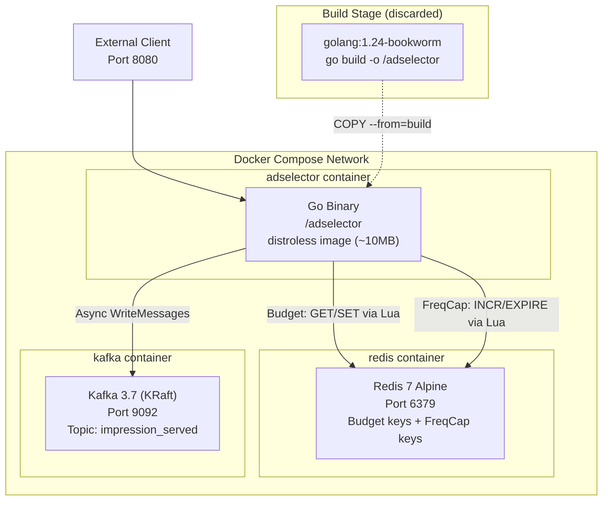

### Dockerfile Breakdown

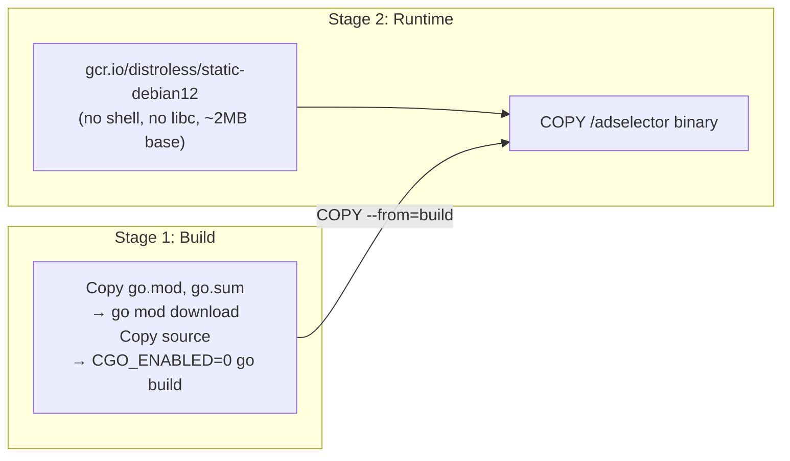

### Repo Files

| What | File |
|------|------|
| Dockerfile (multi-stage) | [`Dockerfile`](../Dockerfile) |
| Docker Compose (3 services) | [`docker-compose.yml`](../docker-compose.yml) |
| Environment config loading | [`cmd/server/main.go`](../cmd/server/main.go) — `loadConfigFromEnv()` |

### Engineering Pattern: **Multi-Stage Docker Build + Distroless Runtime**

Stage 1 uses a full Go SDK image (~800MB) to compile. Stage 2 copies only the binary into a `distroless` base image (~2MB) that contains no shell, no package manager, no libc — only the static binary. This minimizes the attack surface (no shell = no shell exploits) and the image size (~10MB total).

**12-Factor App compliance:** All configuration comes from environment variables (`REDIS_ADDR`, `KAFKA_BROKER`, `BUDGET_BACKEND`, etc.), not config files. This makes the service identical across dev, staging, and production — only the environment variables change.

---

## 12. Dependency Injection: Wiring It All Together

### Plain English

`main.go` is the only file that knows *which* implementations exist. Every other package works against interfaces. This means:

- In **production**: Redis budget tracker, Redis frequency capper, Kafka publisher.
- In **local dev**: In-memory budget tracker, Noop frequency capper, Kafka (or a mock).
- In **tests**: You can pass in mock implementations of any interface.

### Wiring Diagram

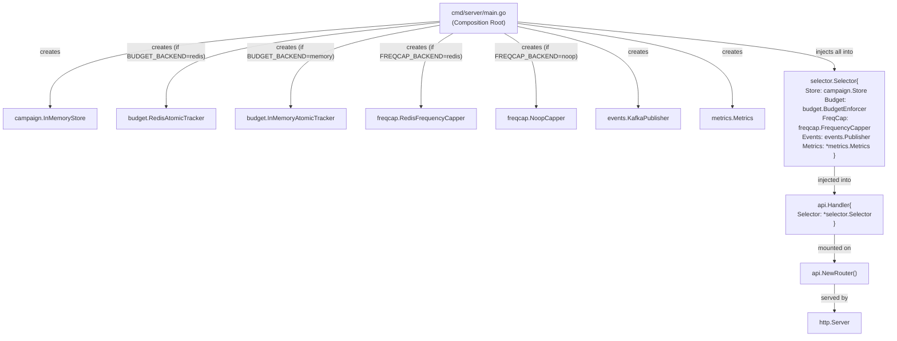

### Repo Files

| What | File | Key Lines |
|------|------|-----------|
| All wiring | [`cmd/server/main.go`](../cmd/server/main.go) | `switch cfg.BudgetBackend`, `selector.Selector{...}` |
| Interface-only dependency in selector | [`internal/selector/selector.go`](../internal/selector/selector.go) | Struct fields are all interfaces |
| Compile-time interface checks | [`internal/budget/atomic.go`](../internal/budget/atomic.go) | `var _ BudgetEnforcer = (*InMemoryAtomicTracker)(nil)` |

### Engineering Pattern: **Composition Root + Constructor Injection**

`main.go` is the **Composition Root** — the single place where all dependency decisions are made. No package imports a concrete implementation of another package's interface. The `selector` package imports `budget.BudgetEnforcer` (an interface), never `budget.InMemoryAtomicTracker` (a concrete type).

Every implementation also has a `var _ Interface = (*Impl)(nil)` line — a **compile-time interface satisfaction check**. If you accidentally remove a method or change a signature, the compiler catches it immediately, not at runtime.

---

## 13. The Concurrency Bug: A Cautionary Tale

### Plain English — The $4.7M Bug

In 2019, a real ad-tech company discovered that their budget enforcement had a race condition similar to the `NaiveTracker` in this codebase. During peak traffic, two servers would simultaneously read a campaign's remaining budget, both see "$500 remaining," and both approve a $500 spend. The campaign spent $1,000 instead of $500. Multiplied across hundreds of campaigns over weeks, the total overspend reached **$4.7 million** before it was caught.

This codebase includes the broken implementation **on purpose** — as a teaching tool with a test that proves the bug.

### The Race Condition Visualized

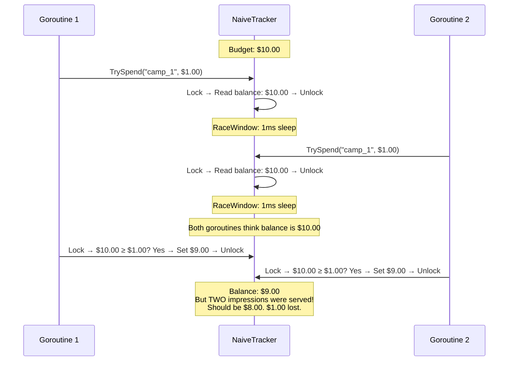

### The Fix: CAS Loop (No Race Possible)

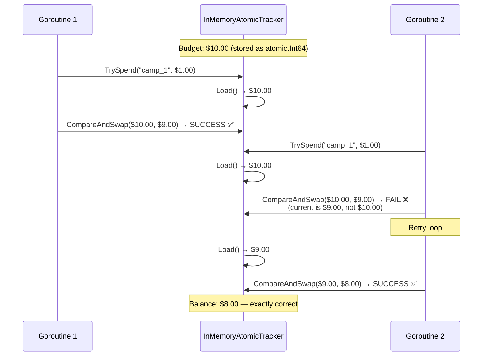

### The Test That Proves It

The test in [`internal/budget/naive_test.go`](../internal/budget/naive_test.go) does this:

1. Seeds a budget of $10 (10,000,000 micros).
2. Launches 20 goroutines, each trying to spend $1.
3. For `NaiveTracker`: More than 10 succeed, or the balance goes negative. **Bug proven.**
4. For `InMemoryAtomicTracker`: Exactly 10 succeed, balance is exactly $0. **Fix proven.**

### Repo Files

| What | File |
|------|------|
| Broken implementation | [`internal/budget/naive.go`](../internal/budget/naive.go) |
| Fixed implementation (CAS) | [`internal/budget/atomic.go`](../internal/budget/atomic.go) |
| Fixed implementation (Redis) | [`internal/budget/redis.go`](../internal/budget/redis.go) |
| Tests proving the race | [`internal/budget/naive_test.go`](../internal/budget/naive_test.go) |
| Decision record | [`docs/adr/0001-naive-vs-atomic-budget-enforcement.md`](../docs/adr/0001-naive-vs-atomic-budget-enforcement.md) |

### Engineering Pattern: **TOCTOU (Time-of-Check-to-Time-of-Use) Bug**

The naive implementation has a TOCTOU race: the *time of check* (reading the balance) and the *time of use* (writing the decremented balance) are separated by a window where other threads can interleave. The CAS loop eliminates this by making the check and the update a single atomic operation. If the value changed between load and swap, the swap fails and the loop retries with the fresh value.

---

## 14. Load Testing: Proving It Works Under Pressure

### Plain English

Before deploying to production, you need to know: "Can this handle 200 requests per second with p99 latency under 200ms?" The codebase provides two load testing tools:

1. **Go load tester** (`cmd/loadtest/main.go`) — a custom-built concurrent HTTP client that reports p50/p90/p99 latencies.
2. **k6 script** (`scripts/loadtest.js`) — an industry-standard load testing tool with configurable QPS and pass/fail thresholds.

### Load Test Architecture

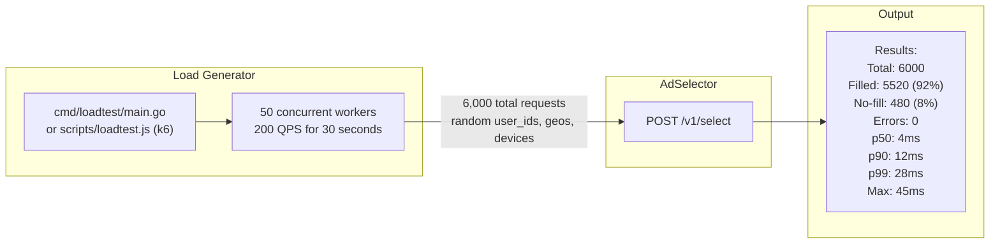

### Repo Files

| What | File | Key Lines |
|------|------|-----------|
| Go load tester | [`cmd/loadtest/main.go`](../cmd/loadtest/main.go) | Semaphore-based concurrency, percentile calculation |
| k6 script | [`scripts/loadtest.js`](../scripts/loadtest.js) | `constant-arrival-rate` executor, p99 < 200ms threshold |
| Go SDK used by load tester | [`pkg/client/client.go`](../pkg/client/client.go) | `Client.Select()` method |

### Engineering Pattern: **Semaphore Pattern for Concurrency Control**

The Go load tester uses a buffered channel as a counting semaphore: `sem := make(chan struct{}, concurrency)`. Before each request, a worker sends to the channel (acquiring a slot). After the request, it receives (releasing the slot). If all slots are taken, new workers block until one finishes. This bounds the maximum in-flight requests without using a mutex or a worker pool library.

---

## Summary: Architecture Principles at a Glance

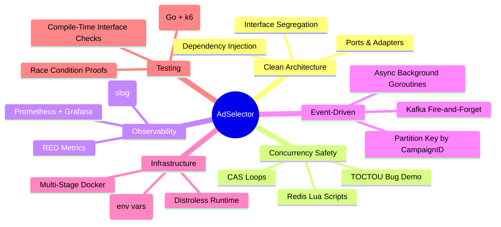

---

## Quick Reference: File Map

| Domain | Files | Pattern |
|--------|-------|---------|
| **HTTP Transport** | `internal/api/handler.go`, `router.go`, `types.go` | Anti-Corruption Layer |
| **Orchestration** | `internal/selector/selector.go` | Pipeline / Chain of Responsibility |
| **Campaign Domain** | `internal/campaign/types.go`, `store.go` | Repository + Strategy |
| **Budget Enforcement** | `internal/budget/interface.go`, `naive.go`, `atomic.go`, `redis.go` | CAS / Optimistic Concurrency |
| **Frequency Capping** | `internal/freqcap/interface.go`, `noop.go`, `redis.go` | Atomic Lua Scripts / Null Object |
| **Event Publishing** | `internal/events/types.go`, `publisher.go`, `kafka.go` | Fire-and-Forget / Event Sourcing |
| **Observability** | `internal/metrics/metrics.go` | RED Metrics |
| **Public SDK** | `pkg/client/client.go` | API Client Pattern |
| **Wiring** | `cmd/server/main.go` | Composition Root |
| **Load Testing** | `cmd/loadtest/main.go`, `scripts/loadtest.js` | Semaphore Concurrency |
| **Infrastructure** | `Dockerfile`, `docker-compose.yml` | Multi-Stage Build / 12-Factor |
| **Documentation** | `docs/architecture.md`, `docs/adr/0001-*.md` | ADR Pattern |
